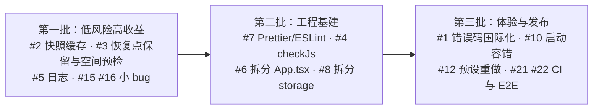

# SaveHub 工程审查：问题与优化建议

> 审查范围：`electron/`、`src/`、`scripts/`、`tests/`、构建与 CI 配置（基于 v1.1.4，提交 `617bc29`）。
> 实测基线：`tsc --noEmit` 通过；`node --test tests/*.test.mjs` 98/98 通过。E2E 未在本次审查中运行。

## 总体判断

**底子扎实，主要短板在"规模化"和"可维护性"。**

做得好的地方（不需要改）：
- Electron 安全基线完整：`contextIsolation` + `sandbox` + IPC 来源校验（[main.mjs#L74-L79](file:///Users/limbo/Workspace/Myself/SaveHub/electron/main.mjs#L74-L79)）+ CSP + 拒绝所有权限请求。
- 读档有事务日志、回滚和启动恢复；全链路都有符号链接防护；写入走原子 `atomicJson`。
- 单元测试覆盖了大量故障注入场景（`fault` 钩子）。

主要问题集中在 4 类：**① 后端错误文案未国际化；② `state()` 全量扫描，存档多了会变慢；③ 磁盘占用只增不减；④ 关键后端代码没有类型检查，前端是一个 55KB 的大组件。**

---

## P1 · 高优先级（直接影响用户或数据规模）

### 1. 后端错误信息未国际化（英文界面会弹出中文报错）

- **位置**：`electron/storage.mjs`、`electron/game-transfer.mjs` 共 **137 处** `new Error('中文…')`，只有 5 处走了 `this.t()`；[main.tsx#L11](file:///Users/limbo/Workspace/Myself/SaveHub/src/main.tsx#L11) 的 `ErrorBoundary` 文案也硬编码成了中文。
- **影响**：用户切到 English 后，几乎所有失败提示（路径不安全、文件正在变化、导入冲突等）仍然显示中文。现有的 i18n 只覆盖了"正常路径"。
- **建议**：
  - 后端抛出带**错误码和参数**的错误（如 `new AppError('snapshot.labelLength', { max: 100 })`），IPC 层序列化成 `{ code, params }`，由渲染层的 `t()` 负责翻译。后端不再维护任何展示文案。
  - 过渡期可先让后端统一走 `this.t()`，但长期来看会形成两套词典（见 #11），不推荐。
  - `ErrorBoundary` 改用 `t()`。

### 2. `state()` 每次刷新都全量读盘，复杂度为 O(游戏数 × 存档数 × 文件数)

- **位置**：[storage.mjs#L249-L285](file:///Users/limbo/Workspace/Myself/SaveHub/electron/storage.mjs#L249-L285)；前端的 [App.tsx `perform`](file:///Users/limbo/Workspace/Myself/SaveHub/src/App.tsx#L87-L98) 在**每次操作成功或失败后**都会调用 `refresh()`。
- **问题**：
  - 每次刷新都要读取并 `JSON.parse` **所有游戏的所有 manifest**。manifest 里带着完整的 `records` 数组（单份最多 10 万条），解析完又被 `publicSnapshot` 丢掉。
  - 每个快照都要执行 `assertNoLinks`，对路径的每一级做一次 `lstat`；同时还要检查每个游戏的路径，并对 `legacyRoot` 做一次 `readdir`。
  - IPC 每次都会回传所有自定义图标的 base64 dataURL（[game-transfer.mjs#L22-L23](file:///Users/limbo/Workspace/Myself/SaveHub/electron/game-transfer.mjs#L22-L23) 允许单个图标最大 3MB），切换主题、收藏一份存档也要重传一遍。
- **影响**：存档少时感觉不到；几十个游戏、每个游戏上百份存档时，每次点击都会明显卡顿。
- **建议**（按收益从高到低）：
  1. 在 `SaveStore` 里加**按 `gameId` 分组的快照摘要内存缓存**，写操作（capture / update / delete / import）完成后只让对应游戏的缓存失效。改动集中，风险最低。
  2. 把 manifest 拆成 `summary`（列表展示所需字段）和 `records`（只在校验、读档时读取），或者在缓存里只保留 summary。
  3. 图标落盘到 `vault/<gameId>/icon.png`，通过自定义协议（`protocol.handle`）加载，`state` 里只传路径或版本号。

### 3. 磁盘占用只增不减，没有容量预检

- **位置**：[restoreSnapshot](file:///Users/limbo/Workspace/Myself/SaveHub/electron/storage.mjs#L546-L595) 每次读档都会创建一份**完整的** safety 恢复点；[capture](file:///Users/limbo/Workspace/Myself/SaveHub/electron/storage.mjs#L378-L411) 每次都是全量复制。代码中找不到任何保留策略，也没有调用 `fs.statfs`。
- **影响**：频繁读档的用户（魂系游戏玩家的典型用法），恢复点会无上限地堆积；磁盘写满时，复制会在中途失败。虽然暂存区会被清理，但用户只能看到一个底层报错（ENOSPC）。
- **建议**：
  - 恢复点加**保留策略**：默认每个游戏保留最近 N 个（比如 10 个），受保护和收藏的不计入；可在设置页调整。
  - 在 capture / restore / export 之前，用 `fs.statfs` 检查剩余空间是否大于 `预计字节数 × 1.1`，不够时给出明确的提示文案。
  - 内容寻址去重（CAS，按文件 sha256 只存一份）能大幅省空间，但会改动存储格式和迁移逻辑，**当前阶段不建议做**。等真有用户反馈容量问题时再评估。

### 4. 最关键的后端代码不在类型检查范围内；IPC 契约要在三处手写同步

- **位置**：[tsconfig.json](file:///Users/limbo/Workspace/Myself/SaveHub/tsconfig.json) 的 `include` 只有 `src` 和 `vite.config.ts`。`electron/*.mjs`（约 1,400 行文件事务代码）和 `scripts/` 完全没有类型检查。
- IPC 的每个方法都要同时改三个地方：[main.mjs `register`](file:///Users/limbo/Workspace/Myself/SaveHub/electron/main.mjs#L84-L140)、[preload.cjs](file:///Users/limbo/Workspace/Myself/SaveHub/electron/preload.cjs)、[types.ts `Bridge`](file:///Users/limbo/Workspace/Myself/SaveHub/src/types.ts#L32-L58)。参数顺序或可选参数改错了，编译期发现不了。
- **建议**：
  - 第一步（零运行时改动）：新增 `tsconfig.electron.json`，开启 `allowJs + checkJs`，对 `electron/` 做检查；关键函数补上 JSDoc 类型。`typecheck` 脚本同时跑这两份配置。
  - 第二步：用一份 channel 列表作为唯一来源，`preload` 按列表自动生成 `invoke` 映射，`Bridge` 类型也从同一份定义推导。

### 5. 主进程完全没有日志，有 10 处静默吞错

- **位置**：`electron/` 里没有任何 `console`，也没有日志文件；`storage.mjs` 有 8 处、`game-transfer.mjs` 有 2 处 `.catch(() => {})`。
- **影响**：用户反馈"读档失败 / 启动恢复异常"时，除了弹窗里的一句话，没有任何可以排查的现场。
- **建议**：在 `userData/logs/` 下写一个轻量的文件日志（按大小滚动，比如保留 2×1MB），记录事务开始、提交、回滚、恢复以及所有被吞掉的错误。设置页增加一个"打开日志目录"入口。不需要引入大型日志库。

---

## P2 · 中优先级（可维护性和健壮性）

### 6. `App.tsx` 是一个巨石组件

- **现状**：371 行，但文件有 **55KB**，单行 JSX 超过 3,000 字符（如 [L234](file:///Users/limbo/Workspace/Myself/SaveHub/src/App.tsx#L234)、[L249](file:///Users/limbo/Workspace/Myself/SaveHub/src/App.tsx#L249)）。`ModalState` 是一个包含 15 种类型的联合；4 个页面、6 个表单和弹窗组件，以及所有业务回调都堆在同一个文件里。
- **影响**：diff 无法审阅（改一个字符，整行变红），代码冲突概率高，新人基本读不下去。
- **建议**：
  - 先用 Prettier 统一格式（纯格式化，没有行为变化），恢复正常行宽。
  - 再做机械拆分：`pages/LibraryPage.tsx`、`pages/ThemesPage.tsx`、`pages/SettingsPage.tsx`、`modals/GameForm.tsx`、`modals/SnapshotForm.tsx`、`modals/RestoreConfirm.tsx`。`perform` 和 `refresh` 抽成 `useSaveHub()` hook。
  - 不需要引入状态管理库，现在的状态量用 hook 就够了。

### 7. 没有 lint 和格式化

- 没有 ESLint、Prettier 或 `.editorconfig`，CI 也不跑 lint。
- **建议**：引入 Prettier 和最小化的 ESLint 规则集（`react-hooks`、`no-unused-vars`），并加入 CI。顺便清理死代码：[format.ts#L11-L14](file:///Users/limbo/Workspace/Myself/SaveHub/src/format.ts) 里的 `setFormatLanguage`、`getFormatLanguage`、`kinds` 都没有被引用。

### 8. `storage.mjs` 职责过多，并且与 `game-transfer.mjs` 循环依赖

- [storage.mjs](file:///Users/limbo/Workspace/Myself/SaveHub/electron/storage.mjs) 共 984 行，混合了路径安全、清单校验、快照、读档事务、存档导入和导出；[game-transfer.mjs#L4](file:///Users/limbo/Workspace/Myself/SaveHub/electron/game-transfer.mjs#L4) 反向 import 了 storage.mjs。目前之所以能运行，是因为相关调用都发生在函数体内，依赖的是 ESM 的初始化时序，比较脆弱。`equal` 也在两个文件里各定义了一份。
- 超过 50 行的函数有 4 个：`exportGames`（64 行）、`exportSnapshots`（63 行）、`prepareImportPlan`（59 行）、`restoreSnapshot`（49 行）。
- **建议**：按依赖方向拆分，不改任何行为：
  ```
  fs-safe.mjs     ← within / assertNoLinks / atomicJson / statMaybe / commitSnapshotDirectory
  manifest.mjs    ← inventory / signature / fingerprint / validateManifest / cleanItems
  restore.mjs / snapshot-import.mjs / snapshot-export.mjs / game-transfer.mjs
  storage.mjs     ← 只保留 SaveStore 类与锁，组合上述模块
  ```

### 9. 用 `JSON.stringify` 做关键的深比较，结果依赖对象键的顺序

- **位置**：[storage.mjs#L15](file:///Users/limbo/Workspace/Myself/SaveHub/electron/storage.mjs#L15)，用于 [replaceImportedSnapshot#L679](file:///Users/limbo/Workspace/Myself/SaveHub/electron/storage.mjs#L679)、[validateImportPlan#L836](file:///Users/limbo/Workspace/Myself/SaveHub/electron/storage.mjs#L836)、[applyImportPlan#L856](file:///Users/limbo/Workspace/Myself/SaveHub/electron/storage.mjs#L856) 中"目标未变化"的判定。
- **风险**：目前两侧数据同源、键顺序一致，所以能用。但以后只要有人调整了 manifest 的构造顺序（例如 `capture` 里展开 `metadata` 的位置），导入流程就会误判为"状态已变化"，让用户无法导入。这是一个潜伏的 bug，不是现在就会触发的问题。
- **建议**：只比较真正有意义的字段，例如 `id + fingerprint + protected + deletedAt + label`，或者给 manifest 加一个单调递增的 `revision`。

### 10. 启动恢复不够容错：一个损坏的日志文件就会让应用无法启动

- **位置**：[recoverTransactions#L634](file:///Users/limbo/Workspace/Myself/SaveHub/electron/storage.mjs#L634)、[recoverImportReplacements#L712](file:///Users/limbo/Workspace/Myself/SaveHub/electron/storage.mjs#L712) 直接 `JSON.parse`，失败就抛错，`init` 失败后 [main.mjs#L37](file:///Users/limbo/Workspace/Myself/SaveHub/electron/main.mjs#L37) 弹框退出。`library.json` 损坏时，`.previous` 备份明明存在，但没有提供恢复入口。
- **建议**：坚持"不静默丢数据"的原则，同时不要把用户锁在应用外面：
  - 把损坏的单个日志移到 `transactions/quarantine/`，写入 `recoveryMessages`，提示用户检查哪个游戏目录。
  - `library.json` 解析失败时，弹窗提供"从上一版本（`.previous`）恢复 / 退出"两个选项，原文件保留为 `.corrupt-<时间戳>`。

### 11. 渲染层 i18n 的状态管理不规范

- [App.tsx#L43](file:///Users/limbo/Workspace/Myself/SaveHub/src/App.tsx#L43) 在 **render 期间**调用 `setLanguage` 修改模块级全局变量（render 中带副作用，StrictMode 下会执行两次）。
- 语言设置同时存在 `library.json` 和 `localStorage` 两个地方；主进程（[i18n.mjs](file:///Users/limbo/Workspace/Myself/SaveHub/electron/i18n.mjs)）和渲染层各维护一套词典。
- **建议**：用 `useSyncExternalStore` 或 Context 承载当前语言；`localStorage` 只用来避免启动首帧的语言闪烁，不作为数据来源。等 #1 落地后，主进程只需要保留菜单和系统对话框的少量文案。

### 12. 预设数据带有作者本地环境的痕迹

- **位置**：[presets.mjs#L14-L37](file:///Users/limbo/Workspace/Myself/SaveHub/electron/presets.mjs#L14-L37)
  - 杀戮尖塔的路径硬编码成了 `D:\Steam\steamapps\common\SlayTheSpire`。
  - 会去解析 `~/Desktop/<Folder>/save.sh` 脚本（作者个人的历史备份方案）。
  - 游戏名硬编码为中文，再由 [format.ts `gameName`](file:///Users/limbo/Workspace/Myself/SaveHub/src/format.ts) 按 id 特判翻译。
  - [App.tsx#L32](file:///Users/limbo/Workspace/Myself/SaveHub/src/App.tsx#L32) 默认选中 `'elden-ring'`。
- **影响**：新用户首次启动，就会看到三个大概率"路径缺失"的游戏。
- **建议**：新装用户默认空库，加上一个"从常见游戏添加"的模板列表（模板名用 i18n key，路径用 `%APPDATA%`、`~/Library` 这类环境变量）。**已有用户的 `library.json` 不受影响**，因为预设只在首次初始化时写入。

### 13. 读档、存档流程中有多余的全量读取

- **现状**：一次 `capture` 会对源数据做 3 次完整读取并计算哈希（inventory → 复制后校验 → `sourceAfter` 再校验），另外还有 1 次复制；一次 `restore` 大约需要 8 次全量读取。
- **影响**：存档在 MB 级时无所谓；到几百 MB 时（部分开放世界游戏、带截图的存档），一次读档要等上数十秒。
- **建议**（不能削弱完整性保证）：
  - 复制时用流同时写入目标文件和计算哈希，省掉一次源数据读取。
  - `sourceAfter` 改为比较 `size + mtimeMs`（`inventory` 已经在逐文件做这类比较），只有发现变化时才重新计算哈希。
  - `restoreSnapshot` 里 safety 刚采集完，紧接着的 `current` 校验可以复用同样的思路。

### 14. 功能入口重复

- 设置页的"已移除的游戏"（[App.tsx#L249](file:///Users/limbo/Workspace/Myself/SaveHub/src/App.tsx#L249)）和"全部游戏 → 已删除"标签功能重叠，而且设置页那块不支持彻底删除。
- **建议**：删掉设置页的这一块，或者把它改成跳转到"全部游戏 → 已删除"的链接。

---

## P3 · 低优先级（小 bug 和细节）

| # | 位置 | 问题 | 建议 |
|---|---|---|---|
| 15 | [App.tsx#L234](file:///Users/limbo/Workspace/Myself/SaveHub/src/App.tsx#L234) | 序号写死为 `0{n} / 0{total}`，游戏达到 10 个后显示成 `010 / 012` | 改用 `String(n).padStart(2, '0')` |
| 16 | [main.mjs#L26-L31](file:///Users/limbo/Workspace/Myself/SaveHub/electron/main.mjs#L26-L31) | 进度节流 80ms，窗口内的事件直接丢弃，**最后一帧**（如 100/100）可能显示不出来 | 改为带 trailing 的节流 |
| 17 | [storage.mjs `within`](file:///Users/limbo/Workspace/Myself/SaveHub/electron/storage.mjs#L40-L43) | macOS 下 `path.posix.relative` 区分大小写，而 APFS 默认不区分，资料库重叠检查可以被大小写差异绕过（边界情况） | 对已存在的路径先 `fs.realpath.native` 再比较 |
| 18 | [index.html#L6](file:///Users/limbo/Workspace/Myself/SaveHub/index.html#L6) | 生产环境的 CSP 里仍保留开发用的 `ws://127.0.0.1:5173` | 通过 Vite 插件只在 dev 模式注入这一项 |
| 19 | [index.html#L8](file:///Users/limbo/Workspace/Myself/SaveHub/index.html#L8) | `href="/build/icon.svg"` 在 `file://` 协议下无法加载 | 改为相对路径，或直接删除（桌面应用用不到 favicon） |
| 20 | [package.json#L61-L67](file:///Users/limbo/Workspace/Myself/SaveHub/package.json#L61-L67) | 只构建 mac `arm64`，Intel Mac 无法使用 | 属于产品决策；如需支持，增加 `x64` 或 `universal` |

---

## 工程与发布

### 21. CI 成本高，但发布环节反而不完整

- **现状**（[build.yml](file:///Users/limbo/Workspace/Myself/SaveHub/.github/workflows/build.yml)）：每次 push 和 PR 都会在双平台全量运行 5 套 E2E 并打包。tag 推送后不会创建 Release，也不会生成 `SHA256SUMS.txt`（开发指南里也承认了这一点），而 `audit:release` 依赖这个文件。
- macOS 用的是 ad-hoc 签名（`identity: "-"`），并且开启了 `hardenedRuntime`，没有公证，用户首次打开会被 Gatekeeper 拦截；Windows 未签名，会触发 SmartScreen 警告。
- **建议**：
  - PR 只跑 `typecheck + unit + smoke`；推送到 main 或打 tag 时再跑全量 E2E 和打包。
  - tag 构建时自动生成 `SHA256SUMS.txt`，运行 `audit:release`，并创建 draft Release。
  - 签名和公证有成本（Apple 开发者账号每年 99 美元），属于发布决策；至少在 README 里写明首次打开的绕过步骤。

### 22. E2E 脚本大量重复，且没有使用测试运行器

- 5 个脚本（`smoke`、`interactions`、`deletion-`、`import-`、`game-interactions`）各自实现了 fixture 创建、`electron.launch`、`dialog` mock、`done()` 计数和清理逻辑。
- 它们是用 `node` 直接执行的脚本，而不是 `@playwright/test` 运行器（虽然依赖已经装了）：没有重试，不能并行，没有 HTML 报告和 trace，遇到第一个断言失败就整体中止。
- **建议**：
  - 低成本方案：抽出 `scripts/lib/harness.mjs`（`createFixture` / `launchApp` / `mockDialog` / `cleanup`）。
  - 彻底方案：迁移到 `@playwright/test`，把每个 `done(...)` 段落改写成一个 `test()`，CI 失败时上传 trace。

---

## 建议的落地顺序



> [!IMPORTANT]
> 所有改动都必须保持现有的磁盘格式兼容，包括 `library.json` 的 `version: 1`、manifest 的 `version: 1`、导出包的 `version: 2`。#2（拆分 manifest）、#3（保留策略）一旦涉及格式变更，必须同时提供只读兼容和迁移逻辑，并补充对应的单元测试。
