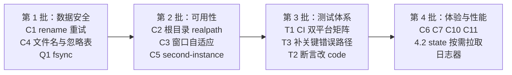

# SaveHub 1.1.5 工程审查：测试体系 · 双平台兼容性 · 优化建议

- 审查基线：`main@535eddc`（工作区干净）
- 审查日期：2026-11-11 ~ 2026-11-18
- 审查环境：macOS / Apple Silicon（`arm64`）、Node `v24.21.0`；Windows 部分为静态审查（本机无 Windows 环境，标注「待 Windows 实测」的条目需在 Windows 上复核）
- 与历史文档关系：`docs/savehub_review_1.1.5.md`、`docs/savehub_review_followup.md` 已覆盖的问题本文不重复，只在仍有残留时注明

---

## 0. 本轮实际执行结果

| 检查项 | 命令 | 结果 |
| --- | --- | --- |
| 单元测试 | `node --test --test-timeout=60000 tests/*.test.mjs` | 147/147 通过，约 8.7s |
| 单元测试覆盖率 | `--experimental-test-coverage`（electron/、shared/） | 行 94.08% / 分支 87.63% / 函数 94.29% |
| 类型检查 | `tsc --noEmit`（TS 7 native） | 通过 |
| ESLint | `pnpm lint` 等价命令 | 通过 |
| Prettier | `pnpm format:check` 等价命令 | 通过 |
| IPC 契约 | `node scripts/generate-preload.mjs --check` | 通过 |
| 渲染进程构建 | `vite build` | 通过（JS 414 KB / gzip 126 KB，CSS 66 KB） |
| 源码 E2E（Apple Silicon） | `playwright test`（7 个套件） | 7/7 通过，2.5 分钟 |
| 打包产物 E2E / 便携版 / 安装器 / APFS 卷 | `test-package` / `test:portable` / `test-installer.ps1` / `test-apfs` | **未执行**（需打包或 Windows 环境） |

> [!NOTE]
> 结论：当前代码在 macOS Apple Silicon 上的源码级回归全部通过。但「全部通过」只说明现有用例没发现问题。下面列的问题里，有几条现有用例本来就不可能发现（例如 Windows 高 DPI 窗口尺寸、macOS 下 `Icon\r` 文件名、Windows 上 `rename` 被占用）。

---

## 1. 结论摘要（建议优先处理）

| 编号 | 优先级 | 问题 | 平台 |
| --- | --- | --- | --- |
| C1 | P1 | 读档事务中的目录 `rename` 没有 EPERM/EBUSY 重试，回滚失败会直接锁住这款游戏 | Windows |
| C2 | P1 | 存档根目录的任一上级目录是符号链接或目录联接（Junction）时，整个游戏都无法使用 | 双平台 |
| C3 | P1 | 窗口默认 1440×960、最小 1060×720，超出常见 Windows 高 DPI 笔记本（例如 1080p@150% 工作区约 1280×672）的可用区域 | Windows / 小屏 Mac |
| C4 | P1 | 跨平台文件名校验先做了 `trim()`，`Icon\r`、`save␠` 这类在 Windows 上非法的名字能通过；`.DS_Store` 等系统文件也会被备份 | macOS → Windows |
| C5 | P2 | macOS 关闭窗口后再触发 `second-instance` 时，会访问已销毁的 `BrowserWindow`，抛出异常 | macOS |
| T1 | P1 | PR 只在 Windows 上做检查；macOS 只在 push 到 main/tag 时验证 | CI |
| T2 | P2 | 64 处断言用中文错误文案正则匹配，E2E 选择器也硬编码中文；改文案或换默认语言会大面积误报 | 测试 |
| T3 | P2 | `errors.mjs` 覆盖率只有 50%，OS 错误映射（EPERM/EBUSY/ENOSPC）完全没测；读档回滚失败（熔断）分支也没测 | 测试 |

---

## 2. 测试文件与用例审查

### 2.1 现状

| 层级 | 文件 | 规模 | 说明 |
| --- | --- | --- | --- |
| 编译期契约 | [contracts.ts](file:///Users/limbo/Workspace/Myself/SaveHub/tests/contracts.ts) | 23 行 | 用 `@ts-expect-error` 校验 Bridge/IPC_SCHEMA 对齐，思路正确 |
| 单元/集成 | [storage.test.mjs](file:///Users/limbo/Workspace/Myself/SaveHub/tests/storage.test.mjs) 等 5 个 | 3063 行 / 147 例 | 在真实磁盘上运行，用 `fault` 钩子注入故障，断言精确到字节 |
| E2E 入口 | [desktop.spec.ts](file:///Users/limbo/Workspace/Myself/SaveHub/tests/e2e/desktop.spec.ts) | 46 行 | 把 `scripts/*-interactions.mjs` 作为子进程运行 |
| E2E 实体 | `scripts/smoke.mjs`、`scripts/*-interactions.mjs` | 约 2000 行 | Playwright + `_electron` |
| 平台专项 | `test-apfs.mjs`、`portable-smoke.mjs`、`test-installer.ps1` | — | 只在 CI 的 package 阶段运行 |

做得好的地方（保持）：

- 每个用例都用 `mkdtemp` 隔离，并在 `t.after` 中做越界保护后清理（`within(root, base) && base !== root`），多文件并行时互不干扰。
- 故障注入覆盖了事务的关键中间态：rename 之后崩溃、safety 备份失败、多条目恢复中途失败、日志损坏隔离。
- 断言针对业务结果本身，例如「`unmanaged.txt` 仍为 `never touch`」「`.savehub-restore-*` 不残留」，而不是只看「没有抛错」。
- `commitSnapshotDirectory` 用注入 `platform`/`rename`/`pause` 的方式，在任何 OS 上都能测到 Windows 重试分支。

### 2.2 问题与建议

#### T1 · P1 · CI 的 PR 检查不覆盖 macOS

- 证据：[build.yml#L11-L29](file:///Users/limbo/Workspace/Myself/SaveHub/.github/workflows/build.yml#L11-L29) 中 `checks` 只用 `windows-latest`；macOS 只出现在 `package` 阶段，而它的条件是 [`if: github.event_name != 'pull_request'`](file:///Users/limbo/Workspace/Myself/SaveHub/.github/workflows/build.yml#L39)。
- 影响：`isCaseInsensitiveDir`、APFS、`darwin` 菜单、`/var` 符号链接这类 macOS 专属分支的回归，要到合并后才会暴露。
- 建议：
  1. `checks` 改为矩阵 `[windows-latest, macos-15]`，至少运行 `lint / format:check / check:contracts / test / build / test:e2e --grep smoke`。
  2. `package` 阶段已经跑过 `pnpm test` + `pnpm build` + 全量源码 E2E，与 `checks` 重复。可以只保留「打包 + 产物回归」，以缩短流水线。
  3. 增加 `concurrency: { group: ${{ github.ref }}, cancel-in-progress: true }`。

#### T2 · P2 · 断言与选择器绑定中文文案

- 证据：单元测试里约 64 处 `assert.rejects(..., /中文/)`，例如 [storage.test.mjs#L1092](file:///Users/limbo/Workspace/Myself/SaveHub/tests/storage.test.mjs#L1092) `/重叠/`、[#L1192](file:///Users/limbo/Workspace/Myself/SaveHub/tests/storage.test.mjs#L1192) `/不安全/`；基于 `error.code` 的断言只有约 32 处。E2E 中类似 [deletion-interactions.mjs#L66-L67](file:///Users/limbo/Workspace/Myself/SaveHub/scripts/deletion-interactions.mjs#L66-L67) `aria-label="读档恢复点"`、`getByRole('button', { name: '确认永久删除 2 份' })`。
- 影响：改一句文案就会导致大量用例失败，而且失败原因不是缺陷；英文界面基本只有 smoke 中的少量检查覆盖。
- 建议：
  - 单元测试统一断言 `error.code`（`AppError` 已带 `code`），文案正确性单独用一个「locale 键存在性 + 插值参数完整」的测试覆盖。
  - E2E 选择器改为从 `shared/locales/zh.json` 读取文案（`t('...')`），或对关键控件加 `data-testid`；再增加一个以 `en` 运行的 smoke。

#### T3 · P2 · 关键错误路径未覆盖

- 覆盖率报告中的缺口：
  - [errors.mjs#L15-L30](file:///Users/limbo/Workspace/Myself/SaveHub/electron/errors.mjs#L15-L30) `serializeError` 为 0%。这是 Windows 上最常见的失败出口（文件被游戏占用 → EBUSY/EPERM），用户看到的提示完全没有验证过。
  - [restore-transaction.mjs#L183-L194](file:///Users/limbo/Workspace/Myself/SaveHub/electron/restore-transaction.mjs#L183-L194) 回滚失败 → `blockedGames` 熔断分支没有测试，[#L248-L251](file:///Users/limbo/Workspace/Myself/SaveHub/electron/restore-transaction.mjs#L248-L251) 「新建条目回滚隔离」分支也没有。
  - [recovery.mjs](file:///Users/limbo/Workspace/Myself/SaveHub/electron/recovery.mjs) 83.75%，日志字段非法（L24-40）的拒绝路径没有测试。
- 建议补充的用例：

| 测试点 | 前置条件 | 操作 | 可验证的预期 |
| --- | --- | --- | --- |
| OS 错误映射 | 构造 `{code:'EBUSY', path:'C:\\a'}` 等 5 类错误 | `serializeError(err,'zh'/'en')` | `code` 分别为 `errors.busy/denied/diskFull/missing/unexpected`，`params.path` 原样透传 |
| 回滚失败熔断 | `fault('after-install')` 抛错，同时让 `rollback` 中的 `fs.rename` 抛 EPERM | `restoreSnapshot` | 抛出 `storage.restoreRollbackFailed`；`blockedGames` 包含该游戏；后续 `createSnapshot` 抛 `storage.gameRecoveryBlocked`；事务日志保留在 `transactions/` |
| Windows 读档 rename 被占用 | 注入 `platform:'win32'`，让 `rename(target, previous)` 第 1 次抛 EBUSY | `restoreSnapshot` | 修复 C1 后应成功；修复前应回滚，且游戏文件逐字节不变 |
| 非法子文件名 | 源目录含 `Icon\r`、`trail␠` | `createSnapshot` | 修复 C4 后应抛 `storage.unsafeRelativePath`（或按忽略规则跳过），且不产生已提交快照 |

#### T4 · P2 · E2E 结构没有用上 Playwright 的能力

- 证据：[desktop.spec.ts](file:///Users/limbo/Workspace/Myself/SaveHub/tests/e2e/desktop.spec.ts) 把 7 个脚本各包成 1 个 `test`；[playwright.config.ts](file:///Users/limbo/Workspace/Myself/SaveHub/playwright.config.ts) 单用例超时 300s，没有 `retries`。
- 影响：一个套件里 51 个检查点中任意一个失败，整个套件只报一条「`xxx exited 1`」，需要翻 `process-log` 才能定位。失败也不能单点重跑，不能用 `--grep` 定位到具体检查点。
- 建议：逐步把 `scripts/*-interactions.mjs` 改为真正的 `test.describe` + `test.step`，夹具由 `createHarness` 改成 Playwright fixture；CI 设置 `retries: process.env.CI ? 1 : 0`，并配合 trace `on-first-retry`。

#### T5 · P3 · 测试夹具重复 5 份

- 证据：`fixture()` 分别定义在 [games.test.mjs#L22](file:///Users/limbo/Workspace/Myself/SaveHub/tests/games.test.mjs#L22)、[import.test.mjs#L14](file:///Users/limbo/Workspace/Myself/SaveHub/tests/import.test.mjs#L14)、[optimization.test.mjs#L13](file:///Users/limbo/Workspace/Myself/SaveHub/tests/optimization.test.mjs#L13)、[remediation.test.mjs#L201](file:///Users/limbo/Workspace/Myself/SaveHub/tests/remediation.test.mjs#L201)、[storage.test.mjs#L15](file:///Users/limbo/Workspace/Myself/SaveHub/tests/storage.test.mjs#L15)，清理参数也不统一（有的带 `maxRetries`，有的没有；在 Windows 上被杀软短暂占用时，没带重试的那几份会残留目录）。
- 建议：抽出 `tests/helpers/fixture.mjs`，统一 `rm(..., { maxRetries: 5, retryDelay: 100 })`；`.test-data` 改为基于 `import.meta.dirname` 计算，不再依赖 `cwd`（目前在其他目录执行 `node --test` 会把数据写到别处）。

#### T6 · P3 · 全局猴补丁 `fs.writeFile`

- 证据：[remediation.test.mjs#L31-L56](file:///Users/limbo/Workspace/Myself/SaveHub/tests/remediation.test.mjs#L31-L56) 通过 `syncBuiltinESMExports()` 替换内置 `fs.writeFile`。
- 影响：目前依赖 `node:test` 在同一文件内串行执行。如果以后启用 `concurrency` 或在同一进程里运行别的 E2E 辅助代码，会产生串扰。用例还会输出一段预期内的堆栈，干扰日志阅读。
- 建议：给 `createHarness` 增加可注入的 `writeReport` 依赖，测试时注入失败实现。

#### T7 · P3 · 平台专项验证太浅

- [test-apfs.mjs](file:///Users/limbo/Workspace/Myself/SaveHub/scripts/test-apfs.mjs) 只校验 `withinOnDisk` 的大小写判定，没有在大小写敏感 APFS 卷上跑一次完整的「备份 → 恢复 → 校验」。建议在挂载卷上复用单元测试夹具，跑核心事务用例。
- 渲染进程没有单元测试（`format.ts`、`useGameReorder.ts` 的排序算法、`i18n`），全部依赖 E2E。像 `useGameReorder.move` 这种纯函数，建议抽出来补表驱动测试，成本很低。
- 失败时保留的夹具（[e2e-harness.mjs#L125](file:///Users/limbo/Workspace/Myself/SaveHub/scripts/e2e-harness.mjs#L125)）没有回收机制，本地反复失败会持续堆积在 `.test-data/`（smoke 每次约 12 MB）。建议在 `pretest` 中清理超过 N 天的目录。

---

## 3. 环境兼容性

### 3.1 Windows

#### C1 · P1 · 读档/回滚中的 `rename` 不容忍 Windows 短暂占用

- 证据：快照提交已经有有界重试（[fs-utils.mjs#L273-L295](file:///Users/limbo/Workspace/Myself/SaveHub/electron/fs-utils.mjs#L273-L295)），但读档安装阶段 [restore-transaction.mjs#L131-L138](file:///Users/limbo/Workspace/Myself/SaveHub/electron/restore-transaction.mjs#L131-L138) 和回滚阶段 [#L239-L251](file:///Users/limbo/Workspace/Myself/SaveHub/electron/restore-transaction.mjs#L239-L251) 直接调用 `fs.rename`。`atomicJson`（[fs-utils.mjs#L313-L328](file:///Users/limbo/Workspace/Myself/SaveHub/electron/fs-utils.mjs#L313-L328)）替换 `library.json` 时同样没有重试。
- 影响：在 Windows 上，Defender、索引服务、资源管理器预览、OneDrive 同步或仍在运行的游戏持有句柄时，目录 rename 会返回 EPERM/EBUSY/EACCES。安装阶段失败会触发回滚；**如果回滚的 rename 也失败，游戏会被加入 `blockedGames`，直到重启才能操作**。最坏情况是用户的实时存档被放在 `.savehub-restore-*/previous` 下。
- 建议：
  1. 把 `commitSnapshotDirectory` 的重试逻辑泛化为 `renameWithRetry(src, dst, { platform })`，在读档安装、回滚、`atomicJson`、导出发布等所有 rename 处复用。回滚路径的退避可以更长（例如总计 2~3 秒）。
  2. 当 EBUSY/EPERM 来自游戏目录时，给出专用提示「请先关闭游戏或同步软件后重试」，而不是笼统的「没有访问权限」（[errors.mjs#L18-L24](file:///Users/limbo/Workspace/Myself/SaveHub/electron/errors.mjs#L18-L24)）。
  3. 目前 `storage.restoreAborted` 直接拼接 Node 原始英文错误（`EPERM: operation not permitted, rename '...'`），中文用户会看到中英混杂的提示。建议先经过 `serializeError` 再嵌入。

#### C3 · P1 · 窗口尺寸超出高 DPI 笔记本的工作区

- 证据：[main.mjs#L137-L140](file:///Users/limbo/Workspace/Myself/SaveHub/electron/main.mjs#L137-L140) `width:1440, height:960, minWidth:1060, minHeight:720`。
- 影响：1920×1080 + 150% 缩放（Windows 笔记本最常见的组合）的逻辑分辨率是 1280×720，扣除任务栏后工作区约 1280×672。`minHeight:720` 已经超出工作区，窗口底部（分页、确认按钮）会被任务栏遮住，用户也无法再缩小。1366×768@100% 同理。macOS 13" MacBook Air 默认 1470×956，960 的高度也会被系统压缩。E2E 只验证了 1080×760（[smoke.mjs#L176](file:///Users/limbo/Workspace/Myself/SaveHub/scripts/smoke.mjs#L176)）。
- 建议：
  - 根据 `screen.getPrimaryDisplay().workAreaSize` 计算初始尺寸：`min(1440, 0.9*w) × min(960, 0.9*h)`。
  - `minHeight` 降到 600~640，并在 E2E 中增加 1280×640 视口下「无溢出且主要按钮可见」的检查。
  - 记住上次的窗口位置和尺寸时，需要校验其仍在某个显示器内（处理外接屏拔出的情况）。

#### C6 · P2 · Windows 标题栏覆盖层颜色固定，不随主题变化

- 证据：[main.mjs#L142-L146](file:///Users/limbo/Workspace/Myself/SaveHub/electron/main.mjs#L142-L146) `backgroundColor:'#f6f5f0'`，`titleBarOverlay.symbolColor:'#75786d'`。全工程没有调用 `setTitleBarOverlay`；而 `cyber` 主题的背景是 `#111220`（[themes.css#L150-L152](file:///Users/limbo/Workspace/Myself/SaveHub/src/themes.css#L150-L152)）。
- 影响：深色主题下，右上角最小化/最大化/关闭按钮的颜色与悬停色都和主题不协调；启动时会先闪一下浅色底。`'#f6f5f000'` 这种带 alpha 的 overlay 颜色在 Windows 上的渲染效果需要实测（**待 Windows 实测**）。
- 建议：`setTheme` 成功后由主进程调用 `window.setTitleBarOverlay({ color, symbolColor })` 和 `setBackgroundColor()`；颜色表与 `themes.css` 共用一份常量。

#### C7 · P2 · 自定义图标对话框允许选择 WebP，但 Windows 上 `nativeImage` 不支持

- 证据：[main.mjs#L273-L277](file:///Users/limbo/Workspace/Myself/SaveHub/electron/main.mjs#L273-L277) 过滤器包含 `webp`/`ico`，随后调用 `nativeImage.createFromPath`。Electron 文档说明 `nativeImage` 在全平台只保证 PNG/JPEG，Windows 额外支持 ICO。
- 影响：Windows 用户选择 `.webp` 时会得到「图片无效」。macOS 能否加载 WebP/ICO 取决于系统解码器，行为可能不一致（**需双平台实测**）。
- 建议：过滤器只保留 `png/jpg/jpeg`（Windows 加 `ico`）；或者在渲染进程用 `` + `canvas` 解码后转成 PNG dataURL，再交给主进程校验。

#### C8 · P2 · 「便携版」并不便携

- 证据：[main.mjs#L20](file:///Users/limbo/Workspace/Myself/SaveHub/electron/main.mjs#L20) 只认 `SAVEHUB_DATA_DIR`，没有处理 electron-builder 便携版注入的 `PORTABLE_EXECUTABLE_DIR`。
- 影响：便携版和安装版共用 `%APPDATA%\SaveHub`。用户把便携版放进 U 盘换电脑使用时，资料库不会跟着走，这与「便携版」的通常含义不符。
- 建议：二选一。要么检测到 `PORTABLE_EXECUTABLE_DIR` 时把 `userData` 设为 `<exe 目录>/SaveHub-data`；要么在 README 中写明「便携版 = 免安装，数据仍在 `%APPDATA%`」。

#### C9 · P3 · 其他 Windows 事项

- 只发布 x64，Windows on ARM（骁龙 X 系列）通过仿真运行，性能和兼容性没有验证。可以评估是否增加 `arm64` 目标。
- `signExecutable: false`（[package.json#L94-L95](file:///Users/limbo/Workspace/Myself/SaveHub/package.json#L94-L95)）会触发 SmartScreen 拦截，README 需要说明「更多信息 → 仍要运行」。
- 读档暂存目录 `<root>/.savehub-restore-<uuid>/previous/<entry>/...` 和快照目录 `vault/<id≤64>/snapshots/.pending-<uuid>/payload/...` 会额外增加 60~130 个字符。Node 自身可以处理长路径，但资源管理器和第三方工具在 260 字符以上会失败，用户手动清理残留时会遇到「路径过长」。建议在 `cleanItems`/`inventory` 中对「`vault` 路径 + 相对路径」超过 240 字符的情况给出预警。
- `copyRecords` 不保留文件属性（只读、隐藏）。存档场景影响很小，但应在文档中说明。

### 3.2 macOS Apple Silicon

#### C2 · P1（双平台）· 上级目录中有任何链接，就拒绝整个存档根目录

- 证据：[fs-utils.mjs#L237-L246](file:///Users/limbo/Workspace/Myself/SaveHub/electron/fs-utils.mjs#L237-L246) 的 `assertNoLinks` 从文件系统根开始逐级 `lstat`；[storage.mjs#L642](file:///Users/limbo/Workspace/Myself/SaveHub/electron/storage.mjs#L642) 对存档根目录调用它。本机实测：

  ```text
  REJECT /var/folders/.../T   为避免操作到其他目录，不支持符号链接或目录联接：/var
  REJECT /tmp/x               …：/tmp
  OK     ~/Library/Application Support
  ```

  测试也因此只能放在项目内的 `.test-data`，而不能用 `os.tmpdir()`。
- 影响：
  - Windows：用 `mklink /J` 把游戏或存档目录迁到其他盘，是极其常见的省空间做法；旧路径 `C:\Documents and Settings` 本身也是 Junction。这些用户会直接得到「不支持符号链接」的错误。
  - macOS：`/tmp`、`/var`、`/etc` 都是系统符号链接；把 `~/Documents` 或游戏目录用符号链接迁到外置盘的用户同样无法使用。
- 建议：区分「根目录之上」和「根目录之内」。保存游戏配置时用 `fs.realpath` 把根目录规范化，并存储真实路径（或者每次使用前解析一次）；`assertNoLinks` 只检查根目录**之下**的条目。这样既保留了「备份树内部不能跟随链接越界」的安全目标，也不会误伤上级目录。`withinOnDisk` 已经基于 `dev+ino` 判定，和这个方案兼容。

#### C4 · P1 · 跨平台文件名校验存在漏洞，且会备份系统元数据文件

- 证据：[fs-utils.mjs#L65](file:///Users/limbo/Workspace/Myself/SaveHub/electron/fs-utils.mjs#L65) `cleanItems` 先 `value.trim()` 再校验；[fs-utils.mjs#L394-L396](file:///Users/limbo/Workspace/Myself/SaveHub/electron/fs-utils.mjs#L394-L396) 对子文件名调用同一个函数，但后续用的是**未 trim 的原名**。本机实测 `inventory` 的结果：

  ```json
  ["saves", "saves/.DS_Store", "saves/Icon\r", "saves/trail "]
  ```

- 影响：
  1. Finder 为自定义图标文件夹生成的 `Icon\r`、以空格结尾的文件名，在 Windows 上都是非法或会被 Win32 静默改名。macOS 上生成的快照拿到 Windows 恢复时，要么失败，要么文件名被改写后触发 `postRestoreVerifyFailed` 回滚。这与代码注释「确保在一个操作系统上创建的备份可在另一个操作系统上安全恢复」的承诺不一致。
  2. `.DS_Store`、`._*`、`Thumbs.db`、`desktop.ini` 会被备份和恢复。Finder 浏览存档目录时会异步写 `.DS_Store`，可能导致：内容相同的两次备份指纹不同，导入去重失效；备份过程中命中 `storage.fileChanging`，偶发失败。
- 建议：
  - 子文件名校验不要 trim，原名不合法就拒绝（或给出明确提示）。
  - 引入一份系统元数据忽略表（`.DS_Store`、`._*`、`Icon\r`、`Thumbs.db`、`desktop.ini`、`.localized`），在 `inventory` 中跳过，并记录到 manifest 的 `ignored` 计数，便于排查。
  - 文件名统一 `normalize('NFC')` 后再进行比较和去重。HFS+ 或 exFAT 外置盘上的 NFD 文件名恢复到 Windows 后，游戏可能找不到对应文件。

#### C5 · P2 · 窗口关闭后再次启动应用（`second-instance`）会访问已销毁的窗口

- 证据：[main.mjs#L43-L48](file:///Users/limbo/Workspace/Myself/SaveHub/electron/main.mjs#L43-L48) 直接调用 `window.isMinimized()`；全文件没有 `window.on('closed', () => window = undefined)`。macOS 关闭最后一个窗口后应用不会退出（[main.mjs#L94-L96](file:///Users/limbo/Workspace/Myself/SaveHub/electron/main.mjs#L94-L96)）。
- 影响：macOS 上关闭窗口后，通过 `open -n`、Spotlight 或 Dock 外的方式再次启动时，主进程会抛出 `Object has been destroyed`，界面无响应。
- 建议：

  ```diff
  # electron/main.mjs
   app.on('second-instance', () => {
  -  if (window) {
  -    if (window.isMinimized()) window.restore();
  -    window.focus();
  -  }
  +  if (!window || window.isDestroyed()) return createWindow();
  +  if (window.isMinimized()) window.restore();
  +  window.focus();
   });
   // createWindow() 内
  +  window.on('closed', () => { window = undefined; });
  ```

#### C10 · P2 · ad-hoc 签名与 TCC 隐私权限

- 证据：[package.json#L123-L124](file:///Users/limbo/Workspace/Myself/SaveHub/package.json#L123-L124) `hardenedRuntime: true`、`identity: "-"`，没有公证，没有 `extendInfo`。
- 影响：
  1. 从网络下载的 DMG 会带 quarantine 属性，Apple Silicon 上会提示「已损坏，无法打开」。README 目前没有说明 `xattr -dr com.apple.quarantine`，也没有说明「右键 → 打开」。
  2. ad-hoc 签名的 cdhash 每次构建都会变化，用户授予的「文件与文件夹」权限（`~/Documents`、`~/Desktop`、外置卷）在每次升级后可能失效，需要重新授权。macOS 14+ 访问其他应用的 `~/Library/Containers` 时还会触发「访问其他 App 的数据」弹窗（**需实测**）。
  3. 被 TCC 拒绝时返回 EPERM，UI 只显示「没有访问权限」，没有引导到「系统设置 → 隐私与安全性」。
- 建议：在 `mac.extendInfo` 中补充 `NSDocumentsFolderUsageDescription`、`NSDesktopFolderUsageDescription`、`NSRemovableVolumesUsageDescription`、`NSNetworkVolumesUsageDescription` 文案；在 darwin 下给 EPERM 增加引导文案；发布说明中写明 Gatekeeper 绕过步骤。条件允许时接入 Developer ID 签名和公证。

#### C11 · P3 · macOS 体验细节

- 应用菜单缺少 `close`（⌘W）、`hideOthers`、`unhide`、`services`、`front`（[main.mjs#L109-L125](file:///Users/limbo/Workspace/Myself/SaveHub/electron/main.mjs#L109-L125)），⌘W 无法关闭窗口，不符合 HIG。建议直接使用 `{ role: 'appMenu' }`、`{ role: 'editMenu' }`、`{ role: 'windowMenu' }`。
- 只有右侧 `.titlebar` 可以拖拽（[styles.css#L121-L124](file:///Users/limbo/Workspace/Myself/SaveHub/src/styles.css#L121-L124)），侧边栏顶部 52px（红绿灯所在行）不能拖动窗口。
- 字体栈 `'Segoe UI', 'Microsoft YaHei UI', 'PingFang SC', sans-serif`（[styles.css#L7](file:///Users/limbo/Workspace/Myself/SaveHub/src/styles.css#L7)）在 macOS 上拉丁字符会落到 PingFang 而不是 SF。建议加上 `-apple-system, BlinkMacSystemFont`。`'KaiTi', 'STKaiti'`（[styles.css#L586](file:///Users/limbo/Workspace/Myself/SaveHub/src/styles.css#L586)）在新版 macOS 上默认都没有安装（楷体-简 需要在「字体册」中下载），实际会回退到宋体。

### 3.3 跨平台一致性

- **路径比较规则不统一**：[snapshot-import.mjs#L178-L180](file:///Users/limbo/Workspace/Myself/SaveHub/electron/snapshot-import.mjs#L178-L180) `importMatches` 只在 `win32` 下折叠大小写，而 `within()`（[fs-utils.mjs#L102-L109](file:///Users/limbo/Workspace/Myself/SaveHub/electron/fs-utils.mjs#L102-L109)）在 `darwin` 下也会折叠，两者都没有做 NFC 归一化。在默认大小写不敏感的 APFS 上，用不同大小写或 NFD 路径重复导入同一个目录，去重会失效。建议收敛为一个 `pathKey(platform, p)` 工具函数，统一执行 `resolve → NFC → (win32|darwin ? lower : 原样)`；大小写敏感卷由 `withinOnDisk` 兜底。
- **主题列表维护了两份**：[ipc-schema.mjs#L85](file:///Users/limbo/Workspace/Myself/SaveHub/shared/ipc-schema.mjs#L85) 与 [storage.mjs#L77](file:///Users/limbo/Workspace/Myself/SaveHub/electron/storage.mjs#L77) 各写一份，建议放进 `shared/` 作为单一来源。

---

## 4. 正确性、性能与工程化改进

### 4.1 正确性

| 编号 | 优先级 | 问题 | 证据 | 建议 |
| --- | --- | --- | --- | --- |
| Q1 | P2 | 快照数据文件没有 fsync，断电后可能提交「目录在、内容为 0 字节」的快照（manifest 有 fsync，payload 没有） | [fs-utils.mjs#L493-L510](file:///Users/limbo/Workspace/Myself/SaveHub/electron/fs-utils.mjs#L493-L510) | 在 `output.close()` 前执行 `await output.sync()`；或在 `commitSnapshotDirectory` 前统一 sync。性能代价可以接受（存档普遍较小） |
| Q2 | P3 | `setTheme`/`setLanguage` 先修改内存再落盘，失败时不回滚，与其他 setter 的风格不一致 | [storage.mjs#L484-L502](file:///Users/limbo/Workspace/Myself/SaveHub/electron/storage.mjs#L484-L502) | 沿用 `previous` 快照回滚的写法 |
| Q3 | P3 | `copyRecords` 每个 chunk 调用一次 `FileHandle.writeFile`，语义依赖「从当前位置写」，可读性差 | [fs-utils.mjs#L498](file:///Users/limbo/Workspace/Myself/SaveHub/electron/fs-utils.mjs#L498) | 改为 `await output.write(chunk)`，或直接用 `pipeline(readStream, hashTransform, writeStream)` |
| Q4 | P3 | `gameInput.icon` 在 IPC 层没有长度上限，过大的 dataURL 要等到 `normalizeGame` 才会被拒绝 | [ipc-schema.mjs#L44](file:///Users/limbo/Workspace/Myself/SaveHub/shared/ipc-schema.mjs#L44) | 在 schema 层加 `str.length ≤ 4MB` 的硬上限，提前拒绝 |

### 4.2 性能（历史问题的残留状态）

- **备份时源文件读取 2 次，暂存区读取 1 次**：[storage.mjs#L739-L763](file:///Users/limbo/Workspace/Myself/SaveHub/electron/storage.mjs#L739-L763)，`copyRecords` 已经流式算出 SHA-256，`sourceAfter` 又做了一次全量哈希。复制阶段已经比对过 `ino/size/mtime` 前后一致，`sourceAfter` 可以改用元数据签名（`hash:false`），对大存档能省掉约 1/3 的 I/O。代价是放弃对「改写后 mtime 恢复原值」这种极端情况的检测，需要产品层确认。
- **读档约 6 次全量读取**：`verify`（读快照）→ safety 复制 + 校验（读实时存档 2 次、读暂存 1 次）→ 复制快照到暂存区（读快照）→ 最终校验（读实时存档）。快照的两次读取可以合并：复制到 `next` 时用 `record.sha256` 流式比对，就能省掉前置的 `verify`（`copyRecords` 已支持 `record.sha256` 不一致时抛错）。
- **`state()` 是全量刷新**：每次操作后 [useSaveHub.ts](file:///Users/limbo/Workspace/Myself/SaveHub/src/hooks/useSaveHub.ts) 都会调用 `api.state()`，后端对每款游戏执行 `location()`（多次 lstat）、读取旧版目录，并对每个快照执行 3 次 `lstat`。[storage.mjs#L325](file:///Users/limbo/Workspace/Myself/SaveHub/electron/storage.mjs#L325) 列表缓存 1 秒就过期。游戏×快照达到上万条时，每次点击都要经历数万次 syscall 加一次大对象结构化克隆。建议：`state()` 只返回游戏摘要和计数，当前游戏的快照列表按需单独拉取（新增 `snapshots(gameId)` 命令）；缓存只依赖目录签名失效，不再依赖 1 秒 TTL。
- **日志器**：[classified-logger.mjs#L220-L260](file:///Users/limbo/Workspace/Myself/SaveHub/electron/classified-logger.mjs#L220-L260) 每条日志都要执行 `fs.stat(dataDir)` + `assertNoLinks`（约 8~10 次 lstat）+ `records.includes`（O(n)）；`trim` 中使用 `records.shift()`，最坏情况是 O(n²)。全部记录常驻内存，而上限可以设到 1024 MB。另外 `logger.run` 会 `await` 写入「started」日志之后才执行业务，每次 IPC 都多一个串行 I/O。建议：目录校验结果做缓存；`records` 改为环形结构或按文件分桶；业务开始前的日志改为不等待写入完成（失败时降级）；把日志上限收紧到 ≤ 200 MB。

### 4.3 工程化

| 编号 | 优先级 | 问题 | 建议 |
| --- | --- | --- | --- |
| E1 | P2 | 版本号散落多处：[package.json#L67](file:///Users/limbo/Workspace/Myself/SaveHub/package.json#L67) `release/1.1.5`、README 第 9 行等硬编码 `1.1.5`，每次发版都要手动同步 | `directories.output` 改为 `release/${version}`（electron-builder 支持文件宏）；README 用通配说明 |
| E2 | P3 | `build`、`pack:*`、`dist:*` 四个脚本重复写 `generate-preload --check && tsc && vite build` | 增加 `"prebuild"`/`"verify"` 脚本复用，例如 `"dist:win": "pnpm build && electron-builder ..."` |
| E3 | P3 | `scripts/dev.mjs` 没有监听 `child.on('error')`，Electron 启动失败时 Vite 服务器会残留 | 补充 error 处理并关闭 server |
| E4 | P3 | CI 没有缓存 Electron 二进制，也没有 concurrency 取消 | 缓存 `~/.cache/electron`、`%LOCALAPPDATA%\electron\Cache` |
| E5 | P3 | 渲染进程完全没有 `memo`/`useMemo`，`App.tsx` 有 1027 行；`styles.css` 有 3203 行（60 KB） | 当前数据量下没有观察到卡顿，先不改；等第 4.2 节的「state 按需拉取」落地后，再按页面拆分组件和 CSS |

---

## 5. 建议执行顺序



每一批的完成标准：

1. 第 1 批：新增第 2.2 节表中「回滚失败熔断」「Windows 读档 rename 被占用」「非法子文件名」三条用例，且在 Windows CI 上通过。
2. 第 2 批：在 Windows 用 Junction 迁移目录、macOS 用 `/tmp` 下的根目录，都能完成备份和恢复；1280×640 视口的 E2E 无溢出。
3. 第 3 批：PR 在两个平台都运行 smoke；`errors.mjs` 覆盖率 ≥ 90%；中文正则断言降到 0。
4. 第 4 批：用 `scripts/benchmark.mjs` 对比改动前后，`state()` 在 50 款游戏 × 200 个快照下的耗时下降，并记录数据。

---

## 6. 复跑命令

```bash
# 静态检查与单元测试
pnpm lint && pnpm format:check && pnpm check:contracts && pnpm typecheck
pnpm test
node --test --experimental-test-coverage \
  --test-coverage-include='electron/**' --test-coverage-include='shared/**' tests/*.test.mjs

# 源码 E2E（需要图形会话）
pnpm build && pnpm test:e2e

# 打包产物回归（按平台）
pnpm dist:mac && node scripts/test-package.mjs && node scripts/test-apfs.mjs      # macOS arm64
pnpm dist:win && node scripts/test-package.mjs && pnpm test:portable \
  && pwsh -NoProfile -File scripts/test-installer.ps1                              # Windows x64
```
